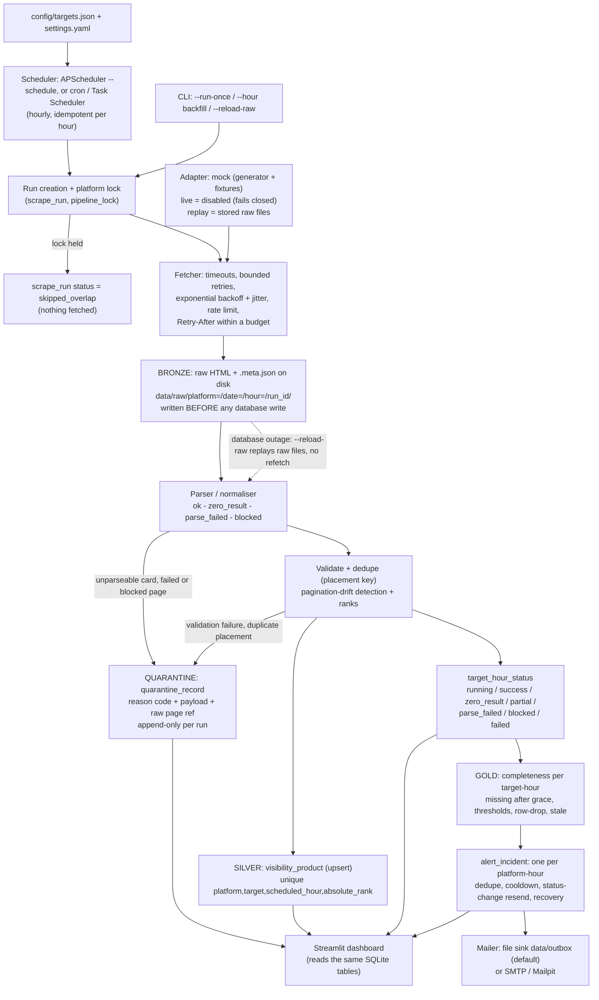

# Architecture

## Boundaries

- **Configuration** is data: keywords, pages, retry, rate, grace and alert settings live in `config/`; secrets only in `.env`.
- **Adapters** do one thing, fetch a page. Retry, backoff, jitter and rate limiting live outside them (`collectors/fetcher.py`, `collectors/ratelimit.py`) so they are unit-testable. `MockAdapter` has no network code; `AjioAdapter` raises `PermissionError`; `ReplayAdapter` serves stored raw files.
- **Raw layer (Bronze):** every response is written to disk with a metadata sidecar before the database is touched, partitioned `platform=/date=/hour=/<run_id>/`, where date and hour are the IST slot (10:00 IST slot -> `date=2026-10-16/hour=10`). Partitioning by hour matches how the data is queried, reloaded and expired; the run id keeps reruns from overwriting each other.
- **Parsing** separates an explicit no-results marker from a missing grid, and detects blocked/challenge pages. HTTP status is checked first.
- **Normalisation:** missing or ambiguous values stay NULL. Placement type is part of the dedupe key, so SP and Organic copies of one product are both kept.
- **Quarantine:** rejected cards, placements and pages go to `quarantine_record` with a reason code, the payload and the raw page path (`docs/quarantine.md`). It is evidence, not a dependency: a failed write never changes a status, and `--reload-raw` rebuilds it.
- **Silver:** `visibility_product`, unique on `(platform, target_id, scheduled_hour, absolute_rank)`; a complete parse replaces the slot, a partial one never deletes earlier good rows.
- **Status / Gold:** completeness is measured from `target_hour_status`, not from product row counts, so a valid zero result is complete and a layout change is not. Aggregates are SQL views (`gold_hour_summary`, `gold_keyword_hour`, `gold_product_placement`, `gold_quarantine_summary`; see `docs/gold_layer.md`).
- **Locking:** one platform-wide lock row. A second run is recorded as `skipped_overlap`. A lock is cleared when its run is finished, or after 4 hours.
- **Alerting:** incidents are persisted; email failure never loses state.

## Key and relationship summary

`scrape_target (target_id)` 1-n `target_hour_status (platform, target_id, scheduled_hour)` and 1-n `visibility_product`. `scrape_run (run_id)` 1-n `raw_snapshot`, and `visibility_product.run_id` / `target_hour_status.last_run_id` point at the run that last wrote them. `visibility_product.raw_payload_ref` points at the exact raw file. `alert_incident` is one open row per `scheduled_hour`.

## Scheduling and replay

`--schedule` runs one cycle at start and then at the top of each IST hour (minute 30 UTC), followed by completeness checks of the previous and current hour. For a backfill pass an explicit hour to `--run-once --hour ...`. For a failed load use `--reload-raw --hour ...`.
